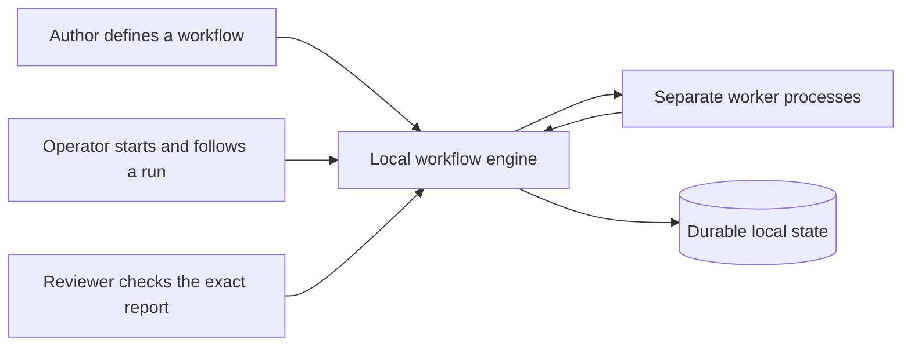

# Durable Workflow Engine

A workflow should be able to wait, retry, and survive a stopped process without losing its place. This project describes a small, local engine that makes those promises precise and gives people a browser interface to understand what happened.

**Project stage:** requirements and design baseline, 19 November 2026. The engine has not been implemented. Examples, SQL, API contracts, and operational commands describe the intended implementation; they are not evidence of a working release.

The first release runs on one machine, offline, with ordinary processes. It supports dependent tasks, parallel branches, durable timers, human approval, bounded retries, and recovery. Its guarantee is at-least-once task execution with fenced updates. Built-in effects live in the same database as workflow state and commit atomically.

## Start reading

| If you want to… | Read |
| --- | --- |
| Understand the problem and scope | [Product requirements](docs/requirements/product-requirements.md) |
| Review every functional requirement | [Software requirements](docs/requirements/software-requirements.md) |
| Understand the whole system | [High-level design](docs/architecture/high-level-design.md) |
| Implement a component | [Low-level design index](docs/design/README.md) |
| Review the public and worker APIs | [API contract](docs/contracts/api-contract.md) |
| Understand database correctness | [Database design](docs/design/database.md) and [transaction protocol](docs/design/transactions.md) |
| Follow every source requirement to a design and test | [Traceability matrix](docs/requirements/traceability.md) |
| Plan delivery and acceptance | [Delivery plan](docs/delivery/implementation-plan.md) and [test strategy](docs/testing/test-strategy.md) |
| Find all documents and diagrams | [Documentation guide](docs/README.md) and [diagram catalog](docs/architecture/diagram-catalog.md) |

## The demonstration

Generate 10,000 synthetic rows, validate them, remove 100 duplicates, and keep 9,850 distinct valid records. Calculate statistics and quality in parallel, wait two seconds, ask a reviewer to approve the exact report, and persist one approved artifact. Kill and restart processes at controlled boundaries to prove recovery.

The proposed reference stack is Python, a locally served HTML/CSS/JavaScript interface, an ASGI control API, and SQLite on local disk. [Architecture decisions](docs/architecture/decisions.md) explain the choice and its limits. Package availability, target-machine compatibility, and performance still need to be confirmed before implementation.

## What is available now

- A reviewed copy of the supplied requirements, preserved [unchanged](docs/source/Durable_Workflow_Engine_Requirements.md).
- Plain-language product, software, quality, interface, and security requirements.
- Architecture, state machines, sequences, and component-level Mermaid diagrams.
- Workflow JSON Schema, a complete example graph, a reference relational schema, and an API contract.
- Acceptance scenarios, failure-injection plans, operational procedures, and honest report templates.
- A documentation validator. Run `node tools/validate-docs.mjs` from this directory.

No application startup script exists yet. Release acceptance is **NOT RUN**. See [review findings](docs/review/source-review.md) for assumptions and [project status](docs/delivery/status.md) for the next milestone.

## License

This project uses the [MIT License](LICENSE).
