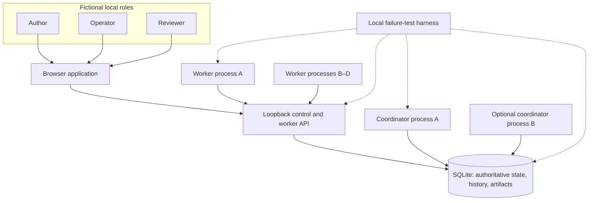
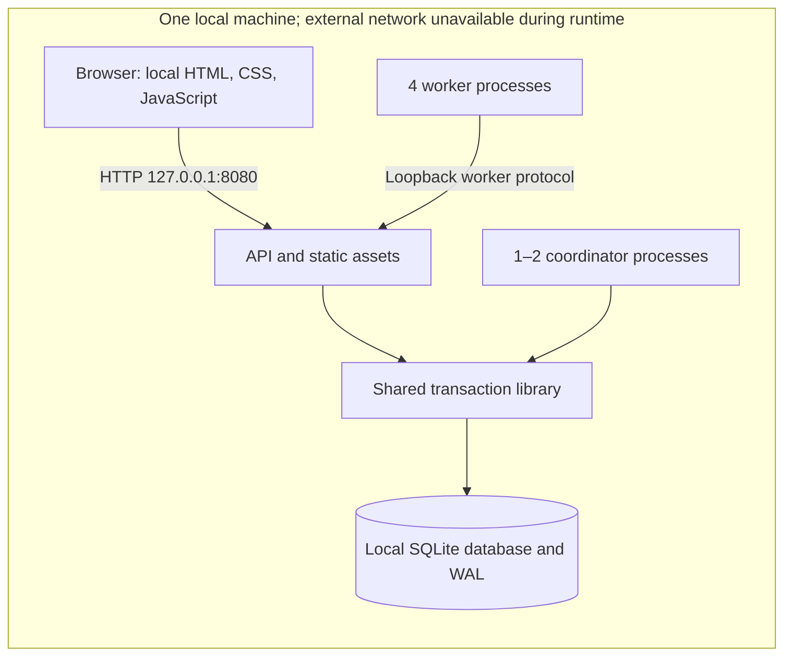
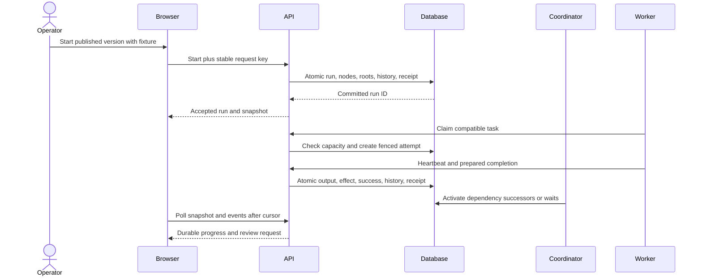

# High-level design

The database remembers what happened. The API accepts human and worker requests. Coordinators find work that is ready or overdue. Workers do the computation. The browser explains these records to people. No component needs an in-memory queue to survive a restart.

## System context

## Deployment

One desktop hosts a browser, one API process, one or more coordinator processes, and four worker processes in the standard acceptance layout. SQLite is embedded in API/coordinator processes and stores a database plus WAL files on local disk. It is not a separate service or a network-shared file.

Keep runtime state outside a OneDrive/synchronized checkout, for example under a dedicated local application-data directory. The source repository can be synchronized; a live WAL database must use a supported local filesystem. All modules use explicit database connections with foreign keys enabled and consistent journal/synchronous settings.

## Responsibilities and interfaces

| Component | Owns | Interfaces and detailed design |
| --- | --- | --- |
| Definition service | Draft revisions, graph validation, immutable publication | Author API; [definition design](../design/definitions.md) |
| Run service | Idempotent starts, snapshots, controls | Operator API; [run lifecycle](../design/run-lifecycle.md) |
| Coordinator | Activation, due waits/retries, expiry, final settlement | Direct transaction library; [coordinator](../design/coordinator.md) |
| Worker protocol/service | Registration, capability matching, claim, heartbeat, completion | Loopback worker API; [workers](../design/workers.md) |
| Handlers | Pure computation and prepared database-contained results | Versioned registry; [handler contract](../contracts/workflow-and-handlers.md) |
| Wait/decision service | Timers and immutable approval requests/decisions | Coordinator and reviewer API; [wait design](../design/timers-approvals.md) |
| Effect service | Stable keys, artifact/output atomicity, completion receipts | Transaction-only entry point; [effects](../design/effects.md) |
| Storage | Constraints, audit order, consistent snapshots | [Database](../design/database.md) and [transactions](../design/transactions.md) |
| Browser | Editing, monitoring, controls, exact review data | Bounded polling; [browser](../design/browser.md) |
| Operations/telemetry | Readiness, counters, structured diagnostics | [Observability](../design/observability.md) and [runbook](../operations/local-runbook.md) |
| Failure harness | Synthetic fixtures, process control, barriers, evidence | [Harness](../design/test-harness.md) |

## A run from start to finish

## Correctness boundary

Every mutation uses `BEGIN IMMEDIATE`, checks its state and time preconditions after acquiring the SQLite write transaction, and commits related history in the same transaction. This serializes conflicting local writes and capacity checks. It also limits write throughput, so transactions contain no handler computation or network waits. This is a proposed design to verify, not a measured performance result.

SQLite documents its single-writer isolation model and write-transaction acquisition behavior. The application-level claim and capacity protocol is this project's design built on those primitives. See [SQLite isolation](https://www.sqlite.org/isolation.html) and [transactions](https://www.sqlite.org/lang_transaction.html).

The guarantee covers process stops and committed local storage under supported settings. It does not establish multi-machine consensus, external exactly-once effects, immunity to disk corruption, or trustworthy time through arbitrary wall-clock changes. Backups and explicit failure outcomes make those limits visible.
