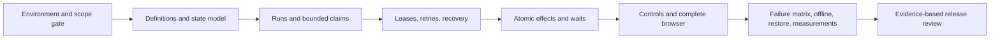

# Delivery plan and release gates

Build one observable slice at a time. These are milestone exits, not promises about the number of hours or sessions needed. Programme eligibility, ownership, and scope approval belong to the participant/reviewer before evaluation-workspace implementation begins.

| Milestone | Deliver and verify | Exit |
| --- | --- | --- |
| 1 | Dependency inventory, pinned stack, local layout, readiness and first browser page | Environment/approval gates recorded; no false-ready storage result |
| 2 | Draft/schema, DAG validation, publication, migrations | AC-01–03/25 relevant cases |
| 3 | Atomic run/root creation, simple worker, history | Sequential run and keyed start work |
| 4 | Parallel branches, joins, capacities, competing claims | AC-04/12/14 |
| 5 | Leases/heartbeat/fences and two coordinators | AC-07–09/13 |
| 6 | Retry classification/backoff, task/run deadlines | AC-05/06/21/26 |
| 7 | Atomic artifacts/effects and immutable receipts | AC-10/11 with required crash repeats |
| 8 | Timers and pinned approvals | AC-17–20 |
| 9 | Pause/resume/cancel/fail-fast races | AC-15/16/26 |
| 10 | Complete accessible browser, diagnostics, two-tab convergence | AC-24/25; all required screens |
| 11 | Canonical fixture/demo, metrics, load/resource measurements | AC-23; all measured targets reported |
| 12 | Full fault matrix, offline setup, consistent restore, handover | AC-22/27/28 and all acceptance evidence |

Each implementation milestone ends with runnable behavior, relevant tests, a commit/checkpoint, and a continuation note. Basic UI/history appear from the first run slice; milestone 10 completes the experience. Deliver source, license notices, schemas/examples, migrations, launch/stop/reset/check scripts, browser, generator, tests, harness, acceptance/performance reports, ADRs, backup guide, and known limitations.

A requirement change must record the source ID, reason, affected contract/design/test, compatibility consequences, and approval owner. Update traceability and schemas together. No silent change from at-least-once computation to “exactly once,” no invented acceptance pass, and no removal of unstable tests to obtain a green report.
