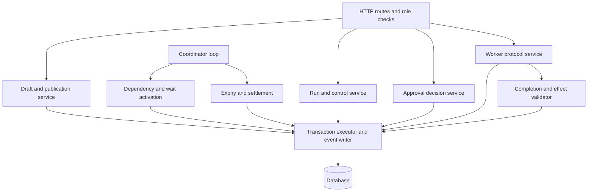

# Low-level design guide

Implement the [transaction protocol](transactions.md) first. Every component below depends on it. Each design identifies its inputs, durable writes, failure behavior, and verification boundary.

| Design | Key question answered |
| --- | --- |
| [Definitions](definitions.md) | What can be published, and how is it kept immutable? |
| [Run lifecycle](run-lifecycle.md) | What does each state mean, and which race can change it? |
| [Coordinator](coordinator.md) | How do ready and overdue records progress after restart? |
| [Workers](workers.md) | How do claims, heartbeats, timeouts, and process stops interact? |
| [Transactions](transactions.md) | What makes concurrent operations safe? |
| [Effects](effects.md) | What commits once, and how is an uncertain response retried? |
| [Timers and approvals](timers-approvals.md) | How do waits survive without occupying a worker? |
| [Database](database.md) | Which records, keys, indexes, and constraints preserve history? |
| [Browser](browser.md) | How does a person see and control authoritative state? |
| [Observability](observability.md) | How can an operator explain a stuck or failed run? |
| [Test harness](test-harness.md) | How do we prove behavior at exact failure boundaries? |

Suggested implementation modules: `api/`, `domain/definitions`, `domain/runs`, `domain/claims`, `domain/completions`, `domain/approvals`, `storage/`, `coordinator/`, `worker/`, `handlers/`, `web/`, `fixtures/`, `tests/`, and `scripts/`. These are a planned layout; runtime source directories are not created by the documentation baseline.
