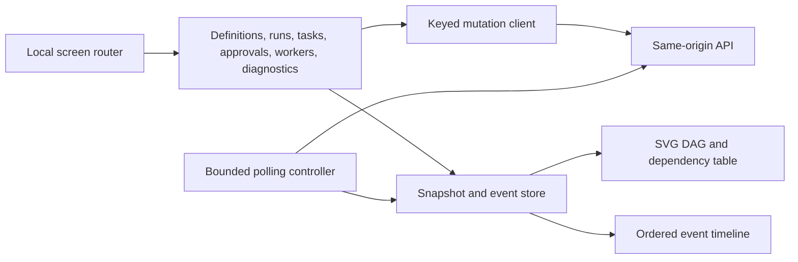

# Browser component design

The browser is a view of committed state. It must remain helpful during a slow request, a changed decision, or a disconnected API without inventing a successful outcome.

| Screen | Data and actions |
| --- | --- |
| Definitions | Draft JSON, revision, validation diagnostics, handler schemas, publish/delete |
| Start | Pinned version/digest, fixture selection, input preview, stable start key |
| Dashboard | Filter-bound cursor, phase, pause flag, workflow/time filters, failed/overdue indicators |
| Run detail | Consistent run/tasks/high-water snapshot, graph and table, control actions, incremental timeline |
| Task detail | Resolved input/output, attempts, worker, lease/deadline, error, retry time |
| Approval inbox/detail | Role-filtered request, exact immutable report/statistics, digest, deadline, expected revision, decision reason |
| Workers | Capabilities, occupied/server capacity, heartbeat age, lost/no-compatible-worker reason |
| Diagnostics | Liveness versus readiness, schema, settings, storage error, metrics summaries |

Poll visible active views every second while healthy. Back off disconnected reads to a bounded interval and show the last confirmed timestamp. Abort obsolete fetches when changing screens; ignore responses older than the current run revision. Start with a consistent snapshot at history sequence H; load older events through H for the timeline and future events after H. Reconcile new snapshots rather than treating events as a second engine.

Store a mutation key and canonical intent before sending, retaining it across a reload in session storage until its outcome is known. Never store disposable authentication tokens in URLs or browser persistence. Identical uncertain requests retry with the same key. A revision/decision conflict opens an explanation and refresh option; it never silently changes the user's intent.

Use textContent/escaped templates for all report, input, error, and node labels. Do not interpret definition HTML. Render controlled report content as text or safe fixed UI fields. Artifact responses download as attachments with controlled content type. Every graph fact is also in a keyboard-accessible table.

Cancellation uses a confirmation dialog explaining that completed effects remain. Disable unavailable actions with a visible reason. Role controls are enforced server-side even when UI controls are hidden. AC-18/24/25/27 and UX-01–07 cover the required browser behavior.
