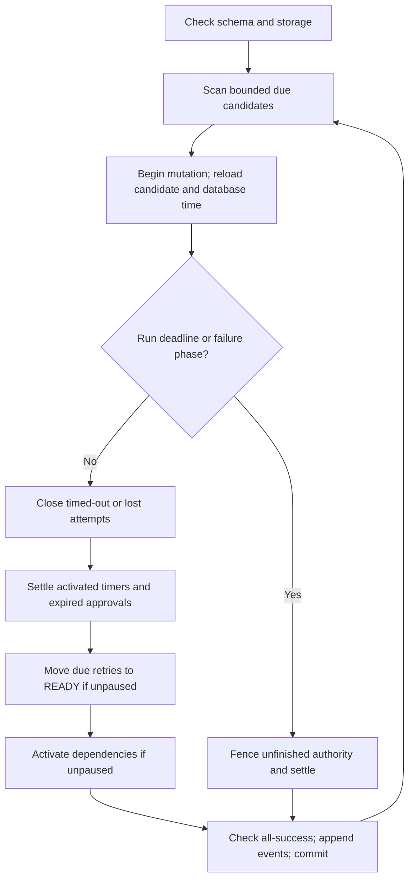

# Coordinator and recovery loop

A coordinator is a repeatable reader of durable obligations. It owns no exclusive in-memory queue, so another coordinator can safely take over or work alongside it.

## Scheduling order and batching

On startup perform the same scans used during normal operation. Scan interval is at most one second, with bounded batches proposed at 50 candidate tasks/runs and one run's changes per transaction. Querying a candidate outside a transaction is an optimization only. Always reload and compare its durable state after acquiring the write lock.

Order work by run deadline/settlement, expired execution deadlines or leases, due approvals/timers, retries, dependency activation, then success settlement. Within a run, check the run deadline first. For an attempt where both execution and lease limits expired, classify TIMED_OUT when execution deadline is no later than lease expiry; otherwise LOST. Persist reason and close authority once.

For a retryable attempt outcome with remaining budget, compute the backoff once from database time, set RETRY_WAIT and `next_eligible_at`, and record `retry.scheduled`. At retry time, unpaused eligible runs move it to READY. Restart never recalculates that stored timestamp. Exhaustion fails the trigger task and initiates fail-fast.

## Dependency activation

Find BLOCKED nodes with no dependency that is not SUCCEEDED. Resolve all input bindings from immutable run input and succeeded ancestor outputs. For worker nodes, validate input and set READY. For timer nodes, store due time and WAITING_TIMER. For approvals, store resolved input, digest, revision 1, role, and effective deadline, then WAITING_APPROVAL. Each activation has a conditional source state and one event.

If input resolution fails, mark FAILED without creating an attempt and settle the run. Missing compatible workers does not fail an otherwise valid node: keep it READY and expose `NO_COMPATIBLE_WORKER` in diagnostics. A declared handler disappearing from the server registry is a startup/compatibility error, not permission to silently run a different version.

Activated timers and approvals continue while paused. BLOCKED nodes and RETRY_WAIT-to-READY transitions do not activate while paused. Run deadlines still apply. If a timer succeeds while paused, its successors remain BLOCKED until resume.

## Multiple coordinators

Two processes may read the same candidate. Only one can mutate at a time. The second reload sees the first's state and returns no change; it appends no duplicate event. No coordinator-leader lease is required for correctness. Avoid long read transactions that retain WAL pages; use bounded keyset scans and fresh snapshots.

## Failure behavior

On storage failure, stop mutation attempts and report not ready. Reconnect with bounded exponential backoff, recheck schema and pragmas, then rescan durable records. Do not replace deadlines with “now plus duration.” Graceful shutdown stops scans after the current bounded transaction. Hard shutdown relies on rollback/committed state. AC-08/13/19/20/22/26 verify recovery, duplicate prevention, and time semantics.
