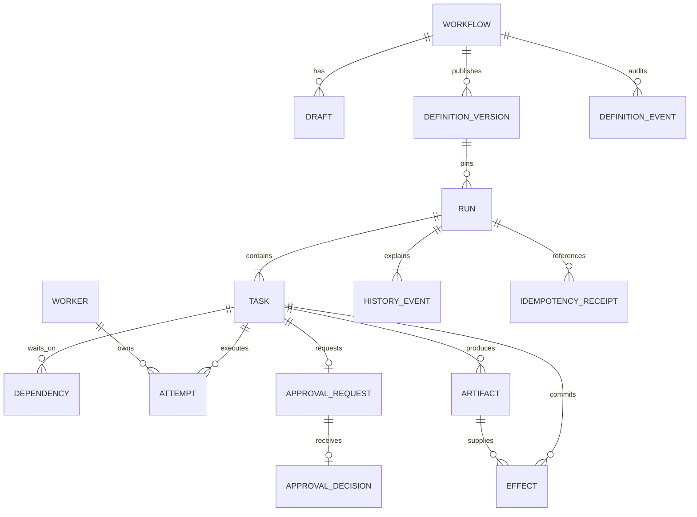

# Database design

The database stores current state, immutable results, and the evidence that explains every accepted change. [Reference DDL](../../schemas/reference-schema.sql) defines the proposed keys and indexes. It is a design artifact, not a deployed migration.

| Record | Important fields and rules |
| --- | --- |
| Workflow/draft/version | Workflow owns version allocation; draft has mutable revision; version has canonical JSON/digest, registry digest, immutable timestamp |
| Run | Definition ID, immutable input/digest, lifecycle, pause, deadline, revision, next event sequence, creation/finish time |
| Task/dependency | One node per run, immutable node identity, state, resolved input/digest, immutable succeeded output, ready/retry/timer times, monotonically increasing fence and claim count |
| Attempt | Unique task/attempt number and task/fence, worker, state, lease, fixed execution deadline, outcome/error; at most one RUNNING row per task |
| Approval request/decision | One request per approval task, pinned version/input/digest, role, deadline, revision; at most one human decision |
| Artifact/effect | Bounded immutable bytes with SHA-256; unique run/node/operation effect and payload digest |
| History | Unique run/sequence; transition, actor, entity, bounded payload, timestamp |
| Definition event | Unique workflow/sequence; publication/draft audit without inventing a run |
| Worker | New instance per process start, capability manifest, slots, last contact, registration state |
| Receipt | Unique actor/operation/target/key scope, canonical request digest, immutable response and response status |
| Fixture | Controlled generated fixture ID, seed, generator version, expected-count manifest and artifact reference |
| Migration | Ordered version/checksum/application time; startup accepts only a supported exact schema |

## Integrity and indexing

Foreign keys use RESTRICT for historical records. Composite task/run references prevent cross-run dependencies and artifacts. CHECK constraints restrict enumerations, booleans, positive capacities, byte lengths, and attempt counters. The DDL cannot alone enforce all state-machine preconditions; only the transaction service may mutate engine tables.

Ready lookup uses `(state,ready_at,id)`, expiry uses running attempt lease/deadline indexes, retries/timers use partial due-time indexes, runs use phase/creation indexes, approvals use status/role/deadline, and history uses the primary run/sequence key. Inspect actual query plans at the retained-data target.

All times are integer UTC milliseconds, all digests are lowercase SHA-256 hex, and IDs are opaque UUID strings. JSON is canonical text at immutable boundaries; artifact payloads are BLOBs. Large data is not copied into every history event.

## Migrations and immutability

Run migrations explicitly with all services stopped, a verified prior snapshot, expected current version, and checksummed scripts. Apply a migration and its version record atomically where supported. Refuse unknown newer schemas. Do not automatically migrate during normal API startup.

Published versions, succeeded outputs, effects, decisions, and receipts have no public update API. Add database triggers for immutable fields in implementation and test both service and direct-database rejection. Baseline reference DDL supplies the relational constraints; migration implementation must add these enforcement triggers before release.

## History and snapshots

Within the run transaction allocate `seq=next_event_seq`, increment it for each event, and insert the corresponding event. Rollback hides both. Increment run revision for any accepted run/task/wait transition. Worker heartbeat contact alone does not append a run event. Read run/tasks and `next_event_seq-1` in one read transaction so the browser knows exactly where incremental history begins.

Back up the entire database, including receipts and artifacts. No retention deletion is designed for release 1. See [restore procedure](../operations/backup-restore.md).
