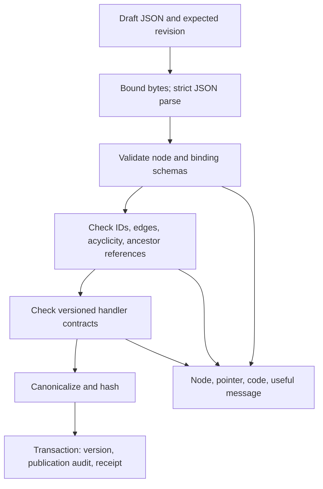

# Definition service

An author should find an invalid dependency before starting work. Publishing therefore validates the entire graph and stores exactly the normalized, canonical document that a run will use.

## Interfaces and algorithm

`validate(document, registry, limits)` returns normalized JSON, digest, topological order, ancestor sets, and structured errors. Bound bytes before parsing; reject duplicate JSON keys. Apply [workflow schema](../../schemas/workflow.schema.json), then semantic checks. Schema validation alone cannot establish graph correctness.

Build `nodes_by_id`, parent sets, and outgoing edges. Reject repeated node IDs, repeated dependencies, missing parents, and self edges. Use Kahn's algorithm with stable node-ID ordering. If visited count is smaller than node count, identify nodes in the remaining cyclic region. Compute each ancestor set from the topological order. Every node-output binding must name an ancestor. Literal JSON stays data even if it resembles SQL, script, or a path; handlers never execute it and accept only their declared fields.

Resolve JSON Pointers using RFC 6901 escaping (`~0`, `~1`); empty pointer selects the entire value. Structural validation proves the referenced ancestor exists. Runtime resolution proves the actual value exists and matches the handler input schema. A missing value fails the consumer with `INPUT_REFERENCE_MISSING` and no worker attempt.

Registry entries are immutable `(handler_name, version)` pairs with contract digests. Definitions record the registry contract digest used at publication; startup rejects incompatible registry substitutions. New handler behavior requires a new version.

## Draft and publication transactions

Draft create returns revision 1 and a receipt. Edit/delete requires expected revision; compare in the transaction and return `REVISION_CONFLICT` on mismatch. Delete only drafts, never a referenced published definition. Keep a definition audit event for accepted draft and publication mutations.

Publish is a two-stage operation: validate a snapshot outside the write transaction, then acquire the write transaction and recheck draft revision and contract registry digest. Allocate the next workflow version, insert canonical document/digest, append publication audit, and store receipt. If the draft changed, return conflict and require revalidation. Same publish key/request returns the original published version; a different key may intentionally publish a new version of unchanged content.

## Failure and tests

Validation and canonicalization errors create no version and no task. A write conflict rolls back the entire publication. Test cycles, duplicates, invalid pointers, ancestor references across parallel branches, handler-version mismatch, maximum graph boundaries, lost publish response, two competing publications, and immutability after version 2. Covers DEF-01–09 and AC-01–03/25.
