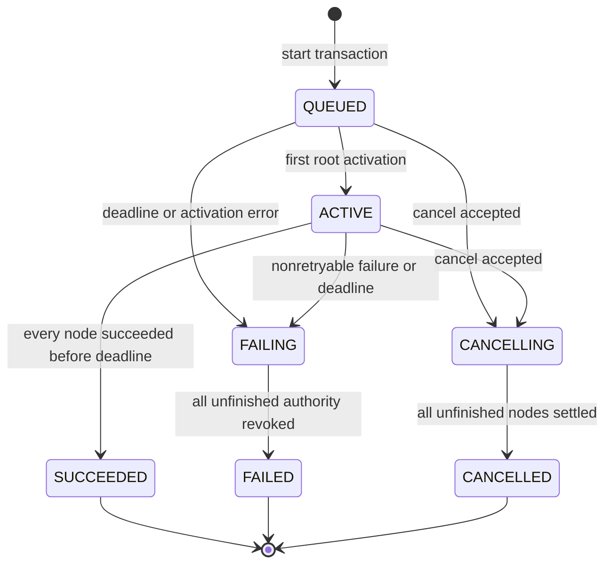
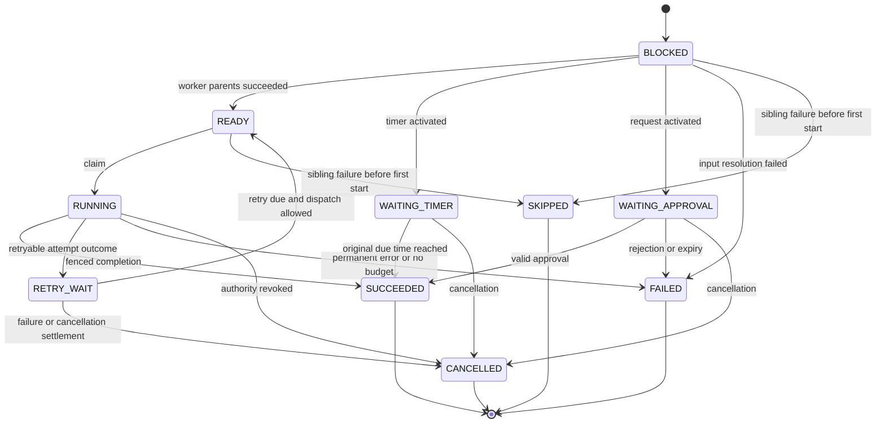

# Run lifecycle and controls

Run state answers whether new work is allowed and how the execution ends. Pause is a separate flag; it does not create a competing lifecycle.

Start validates version/input and key, begins a write transaction, rechecks the immutable version, reads database time, and inserts the run and every node. Activate all roots in this same transaction, with appropriate READY, WAITING_TIMER, or WAITING_APPROVAL state. A root activation makes the normal immediate start response ACTIVE; QUEUED remains an explicit pre-activation state for internal staged creation only. No partially created run is visible. Record `run.created` plus root transitions and an idempotency receipt atomically.

## Task state machine

The diagram shows primary paths. The settlement table below governs every unfinished state, including timer/approval skip outcomes during fail-fast. No terminal node changes state.

| Operation | Preconditions | Atomic result |
| --- | --- | --- |
| Pause | QUEUED/ACTIVE, deadline not expired | Set pause flag, increment revision, append event/receipt; existing attempts may finish |
| Resume | QUEUED/ACTIVE, deadline not expired | Clear pause; preserve every due time and attempt |
| Cancel | QUEUED/ACTIVE, deadline not expired | Set CANCELLING, fence/close active attempts, cancel every unfinished task/wait, settle CANCELLED, append all events/receipt |
| Fail-fast | Nonterminal run; failed task or run deadline | Set FAILING; retain failed trigger; SKIP never-started siblings, CANCEL previously attempted unfinished siblings, fence active attempts, close waits, settle FAILED |
| Success | ACTIVE; every node SUCCEEDED; run deadline still valid | Set SUCCEEDED with event |
| Repeat accepted control | Same operation/key/request | Return immutable receipt even if the run has since become terminal |

Repeated pause/resume with a new key while already in the requested flag state returns a no-change receipt and creates no second state-transition event. Different commands on terminal runs return `RUN_TERMINAL`. CANCELLING and FAILING may be intermediate states within one transaction; clients need not observe them before their terminal outcome.

## Race ordering

Completion, controls, and coordinator actions serialize through the write transaction. Every authority-dependent action rechecks the run deadline. At `now >= deadline`, apply failure settlement rather than accepting new progress. A last valid completion that commits first may finish the run; a later cancellation returns terminal conflict. Cancellation accepted first fences the completion. A failure phase already chosen cannot be replaced by cancellation or reopened by late success.

Task success before the deadline does not by itself bypass run-deadline checking during final settlement. The final completion transaction settles SUCCEEDED immediately if it completes the last node and the deadline is still valid. Timers/approvals use the same terminal check. Thus a coordinator delay cannot turn an already atomically completed run into a deadline failure.

Test pause during active computation, activation versus pause, cancel versus claim/completion, run expiry versus completion, approval expiry while paused, and terminal duplicate receipts. Covers RUN-01–09 and AC-04/06/15/16/26.
