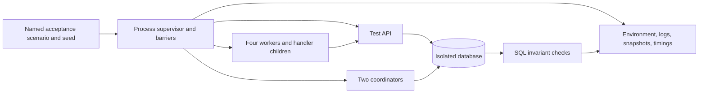

# Failure harness and fixture design

The harness creates real local processes, waits for explicit barriers, stops the intended process, and checks committed records. Random sleeps cannot reliably prove what happened between preparation and commit.

Give each test a new runtime directory, database, port, synthetic identities, seed, and process-instance IDs. Track only PIDs started by the harness and verify their identity before stopping them. Test resets operate on the exact isolated directory and never on a normal user's database.

Required barriers: `after_claim`, `after_effect_prepare_before_commit`, `after_commit_before_response`, and `after_authority_revoked_before_delayed_completion`. A named barrier acknowledges its exact process/task/attempt identity through a test-only local pipe or explicit test-mode endpoint. The harness releases or kills it deliberately. Fault endpoints are absent/disabled in normal mode and require explicit startup test mode plus a separate disposable credential.

For a precommit crash, terminate the process that owns the transaction or halt before the transaction begins; record which boundary was exercised. For a postcommit lost response, allow COMMIT then deliberately drop the response. These are separate tests. Use a controlled fake transport/storage adapter for deterministic unavailability and real close/reopen integration tests for SQLite recovery.

## Canonical generated fixture

Generator `synthetic-records-v1` uses seed 20261119 with an explicitly versioned xorshift32 generator for shuffle (32-bit unsigned shifts), Fisher–Yates order, and no wall-clock/random default. Generate distinct IDs `r000001` through `r009850`, integer value equal to ID number modulo 1000, and category `group-(id modulo 5)`. Add exact copies of the first 100 valid IDs. Add 50 distinct `invalid-000001`…`invalid-000050` records missing the required value. Shuffle using the recorded seed.

Validation removes the 50 invalid rows but retains 9,950 valid rows including duplicates. Normalize identifiers/declared text deterministically, deduplicate by stable ID, reject conflicting duplicate payloads, and sort ascending by ID to obtain 9,850 rows. Statistics operate on integer counts/sums; any decimal average is a canonical decimal string. The quality report records input/valid/invalid/duplicate/distinct counts.

The implementation generator must emit expected canonical output SHA-256 digests into a manifest after generation. Until that implementation and independent oracle exist, digest fields remain absent/NOT GENERATED; do not use invented hexadecimal strings as evidence. A small independently computed golden fixture complements the large fixture so the same bug is not used to generate and check an expected digest.

Run claim/capacity/stale-write contention at least 100 rounds. Run each crash-window case at least 20 times, retaining every failed round. Evidence includes scenario ID, seed, versions, configuration, barrier acknowledgments, process stops, SQL snapshots, receipt/result digests, timings, assertions, and final outcome. See [acceptance catalog](../testing/acceptance-catalog.md).
