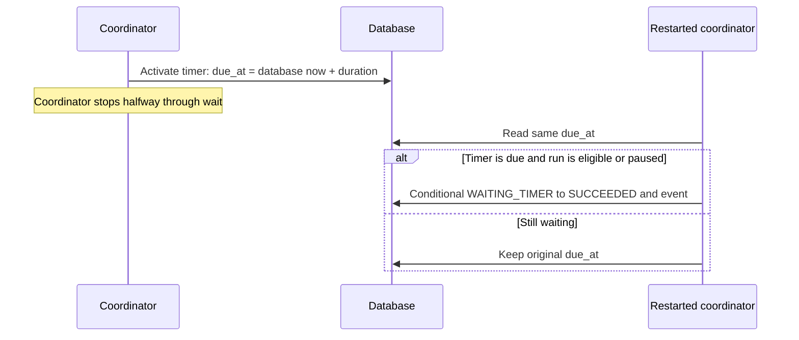

# Durable timers and human decisions

Waiting is a database record, not a sleeping worker. A restart may delay noticing a due time, but it must not start the wait again or change the data a person is being asked to approve.

## Timers



Timer activation requires all parents succeeded, unpaused run, and valid run deadline. Persist `timer_due_at` once. Settling an existing timer is allowed while paused; its successors remain blocked. A run deadline or cancellation takes precedence according to the serialized transaction protocol. There are no attempts or worker capacity slots for a timer.

## Approval request

Activation resolves immutable report/statistics inputs and stores canonical input JSON and digest, run/node, definition version, reviewer role, revision 1, and `min(now+decisionTimeout, runDeadline)`. Artifacts referenced in that manifest are immutable and must belong to allowed succeeded ancestors in the run. The reviewer sees those exact bytes and digests.

```mermaid
sequenceDiagram
    actor R1 as Reviewer tab A
    actor R2 as Reviewer tab B
    participant A as Decision API
    participant D as Database
    R1->>A: Approve request revision 1 with key A
    R2->>A: Reject request revision 1 with key B
    A->>D: Serialize first valid decision; role and deadline checks
    D-->>A: Decision, task outcome, event and receipt committed
    A-->>R1: Accepted decision receipt if tab A won
    A->>D: Recheck request for second transaction
    A-->>R2: 409 decision already settled if tab A won
```

The diagram shows tab A winning; reversing write order reverses the valid winner. Do not resolve conflicts through client timestamps or silently retry a changed decision.

Decision body contains `decision`, bounded reason, expected request revision, and the request input digest the person viewed. Require a matching reviewer role and current request identity. Replay a matching committed decision key before checking pending state; reject a different body under the same key. For a new decision at or beyond its deadline, record expiry/failure settlement and return `APPROVAL_EXPIRED` with the accepted durable outcome. No decision can reopen it.

Approval sets task SUCCEEDED and a small output containing decision ID, request ID, approved input digest, and pinned manifest. Rejection sets the task FAILED and initiates fail-fast. Both commit actor and timestamp with decision, request state/revision, task state, history, and receipt. Expiry has no human decision row; the request becomes EXPIRED with a reason and task/run events.

Paused review is allowed. Approval/rejection/expiry may settle the node; downstream activation remains paused. Cancellation closes pending requests as CANCELLED and rejects late decisions. Definitions and approved bytes cannot be edited through the decision form.

AC-17–20, AC-15/16/18/23/26 cover identity preservation, conflict, timing, pause, and run-deadline interactions.
