# Worker process and protocol

A worker computes results while its current lease allows it. It does not decide that a task succeeded; the API decides whether a submitted result is still authorized and can commit it.

```mermaid
stateDiagram-v2
    [*] --> REGISTERING
    REGISTERING --> IDLE: compatible registry accepted
    IDLE --> CLAIMING: capacity available locally
    CLAIMING --> IDLE: no eligible work
    CLAIMING --> EXECUTING: fenced claim received
    EXECUTING --> SUBMITTING: prepared result or classified error
    EXECUTING --> AUTHORITY_LOST: lease, deadline, control, or storage uncertainty
    SUBMITTING --> IDLE: committed receipt received
    SUBMITTING --> SUBMITTING: uncertain response; same key
    SUBMITTING --> AUTHORITY_LOST: stale or expired unfinished attempt
    AUTHORITY_LOST --> IDLE: discard uncommitted result
    IDLE --> DRAINING: shutdown
    EXECUTING --> DRAINING: stop new claims
    DRAINING --> [*]: bounded finish or exit
```



## Registration and claim

Every process start creates a fresh UUID worker instance. Registration advertises allowlisted `(handler,version,contractDigest)` capabilities and capacity, default one. The server verifies registry compatibility. A bootstrap worker credential is separate from browser roles and stays out of URLs/logs. Each claim uses a new idempotency key; retry an uncertain claim with its original key before requesting another.

An empty-claim receipt returns the same empty result on duplicate. A fresh poll uses a fresh key. A lost successful claim response returns the same attempt; if it is already expired the response includes current authority status and the worker must not execute it. Replayed registration does not resurrect a previously stopped worker instance.

The claim response includes resolved input or controlled artifact IDs, task/attempt IDs, attempt number, fence, contract identity, lease expiry, execution deadline, and run deadline. Worker-local slots limit requests for efficiency; server-side counting is authoritative.

## Computation and heartbeat

Heartbeat every five seconds while executing. Heartbeats identify worker/task/attempt/fence and carry a per-heartbeat key. A valid heartbeat extends lease to `min(now+15s, execution_deadline)` and updates worker contact. It never changes the fixed deadline or revives expired authority. Return 409 with a stable reason when authority is gone; stop/discard further prepared work.

Run heartbeat I/O independently of CPU computation, using a control thread or separate handler subprocess so long computation cannot starve it. Prefer one bounded handler child per claimed slot; this also lets the parent stop computation on cancellation. Parent owns authority and completion submission. Child output is bounded and schema checked. Killing a child is cleanup, not the correctness mechanism.

Handlers may read controlled immutable fixture/artifact bytes and compute prepared outputs. They cannot run arbitrary shell commands, accept arbitrary paths/URLs, or commit external effects. Commit prepared artifact bytes through the API with the result. See [effects](effects.md).

## Lost worker and stale result

```mermaid
sequenceDiagram
    participant W1 as Worker A
    participant A as API
    participant D as Database
    participant C as Coordinator
    participant W2 as Worker B
    W1->>A: Claim task
    A->>D: Attempt 1, fence 1, lease expiry
    Note over W1: Process stops after claim
    C->>D: Close LOST; persist retry timestamp
    W2->>A: Claim due retry
    A->>D: Attempt 2, fence 2
    W1->>A: Delayed result or heartbeat with fence 1
    A->>D: Check task, attempt, fence, time and phase
    A-->>W1: Reject stale authority
    W2->>A: Complete with fence 2
    A->>D: Commit valid result and receipt
```

If database/API availability is uncertain, stop new claims and suspend submission/computation that would rely on unverified authority. On reconnect, fetch attempt status and obtain a valid heartbeat before continuing; if elapsed lease expired, discard the prepared result. A previously committed completion can still be retrieved using its receipt.

Graceful shutdown stops new claims and allows a bounded finish shorter than the remaining deadline. Do not heartbeat forever during drain. Hard stop consumes the claim and recovers through lease expiry. AC-05/07/09/12/14/21/22 verify these paths.
