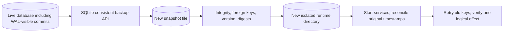

# Backup and restore

A backup must preserve run state, effects, history, artifacts, definitions, and receipts together. Restoring only task rows can repeat a logical effect or lose the proof that a request already committed.

Use Python sqlite3's connection backup interface to a new destination database. Record source application/schema version, time, snapshot digest, and configuration manifest. Check backup errors explicitly. Verify `PRAGMA integrity_check` and `foreign_key_check` on the completed snapshot, plus row counts and artifact/effect digests. SQLite describes the backup facility in its [official guide](https://www.sqlite.org/backup.html); Python documents its [binding](https://docs.python.org/3/library/sqlite3.html).

Do not make a live backup by copying only the main `.db` file. WAL may contain acknowledged commits. Do not mix files copied at different times. A cold copy is acceptable only with all owning processes stopped and the database consistently closed/checkpointed under a documented procedure; the standard implementation path remains the backup API.

Restore to a new validated local directory with services stopped. Preserve the prior runtime untouched. Check schema compatibility and integrity before admitting work. Start API and coordinators, which reconcile original due times and expired leases. Start fresh worker instance IDs. A restored old active attempt cannot be made fresh by resetting its lease.

AC-28 takes a snapshot containing succeeded effects, pending work, and receipts, restores it, retries accepted start/completion keys, and proves unchanged run/effect identity and one committed logical effect. Artifacts and definition digests must match. Time spent outside the running engine still counts against stored deadlines. Never claim recovery to a time later than the snapshot; a backup cannot recover subsequent commits it never contained.
