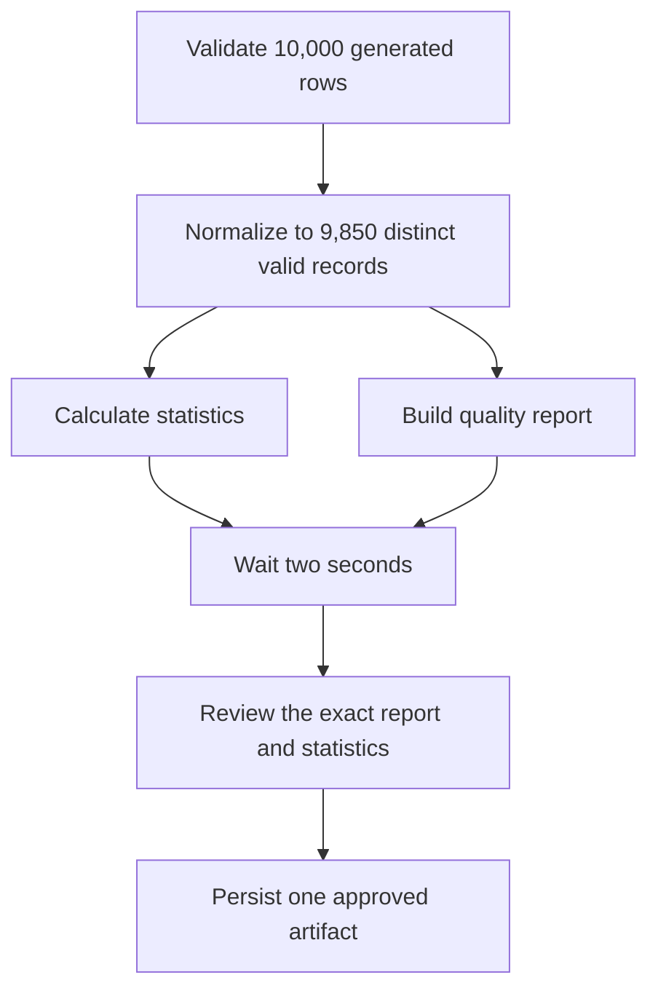

# Product requirements

When a workflow stops halfway through, a person needs to know what finished, what will retry, and what still needs a decision. The engine should answer those questions from committed records even after every browser tab and worker has closed.

## People and outcomes

| Person | Desired outcome | Release requirement |
| --- | --- | --- |
| Author | Publish a graph with useful validation errors | PRD-01: edit drafts, validate, publish immutable versions, inspect handler contracts |
| Operator | Start work once and understand progress | PRD-02: idempotent start, dashboard, task detail, ordered history, clear controls |
| Reviewer | Decide on the exact report they inspected | PRD-03: pinned input digest, visible deadline, auditable approve/reject receipt |
| Developer | Prove safe recovery and add allowlisted handlers | PRD-04: versioned contracts, deterministic failures, repeatable invariant checks |

## Release boundary

PRD-05: execute JSON-defined DAGs with multiple roots, parallel branches, and AND joins. Worker tasks, timers, and approvals are required. PRD-06: survive stopped workers, API/coordinator restarts, and reopening a committed local database. PRD-07: give a complete browser journey and local operating instructions.

Release 1 uses one machine, fictional roles, generated data, loopback services, CPU execution, and locally served assets. It uses no Docker, cloud runtime, external task integrations, arbitrary executable expressions, or real credentials. It does not include loops, conditional routing, compensation, child workflows, partial reruns, or production authentication. A new attempt is automatic policy-driven recovery; a fresh run is a new execution with a new effect namespace.

## Demonstration and success

PRD-08: the demonstration reports 50 invalid records and 100 duplicate valid rows. A reviewer can inspect the exact report before deciding. Restart and failure demonstrations retain identity, timestamps, outputs, and history. The publication task produces one database effect per run/node/operation.

PRD-09: release success requires all AC-01 through AC-28, mandated repetition counts, the offline journey, backup restoration, and measured performance results. A visual demonstration alone does not establish durability.

## Priority and tradeoffs

Every required source feature is mandatory for release 1. Build in vertical slices so useful browser evidence exists early. Correctness takes priority over throughput. If the proposed database cannot meet measured targets, record a revised architecture decision before changing the guarantee or quietly relaxing a limit.

The principal tradeoff is a deliberately small deployment boundary. A local engine is easier to inspect and fail in a controlled way, but it cannot establish behavior under multi-machine partitions or shared-storage failure. Those questions belong to a future release with a different architecture review.

## Product acceptance

An author can publish without touching engine code. An operator can explain an exhausted task and its retry schedule. A reviewer sees a conflict instead of silently replacing another decision. Closing the browser changes none of the work. After a restart, succeeded tasks remain succeeded and unfinished work is either eligible, waiting for a recorded time/decision, or explicitly settled.
