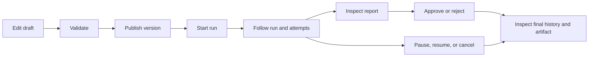

# User journeys and browser acceptance

The interface should speak in terms of a person's work: a report is waiting for review, a worker stopped responding, or a task has no retries left. Keep attempt IDs and fences available in details where they help investigation.

| ID | Journey | Acceptance and recovery |
| --- | --- | --- |
| UX-01 | Author edits and publishes | Show node/field errors; stale edit offers reload without discarding unsaved text; publish returns immutable version/digest |
| UX-02 | Operator starts a run | Select version and fixture, preview input, create key once; double-click/network retry returns the same run |
| UX-03 | Operator investigates | Show graph and equivalent table, current lifecycle and pause flag, attempt errors, next retry, lease/deadline, ordered timeline |
| UX-04 | Reviewer decides | Show exact immutable report/statistics and digest; require deliberate approve/reject; retain reason; 409 prompts refresh and a fresh decision |
| UX-05 | Operator controls work | Pause copy says running work may finish; cancellation dialog says completed effects remain; show accepted server outcome |
| UX-06 | Person reloads or changes tabs | Restore snapshot plus event cursor; stale tabs converge and do not overwrite accepted changes |
| UX-07 | Person diagnoses worker/storage issue | Show last contact, capabilities, occupied slots, readiness cause, and safe next action |

Every screen handles loading, empty, disconnected, stale, forbidden, and server-error states. Status uses text and color together. Focus order follows the visual order; dialogs return focus to their trigger; validation summaries link to the affected field. The graph is optional visual assistance: the dependency table provides the full keyboard-accessible equivalent.

Suggested language: “Paused. Tasks already running may finish.” “This decision was already made in another tab. Refresh to see it.” “Your request may have been saved. Retrying will use the same request key.” “This task stopped responding. Attempt 2 is scheduled for 10:04:15.” Avoid promising that cancellation rolls anything back.

The browser records a mutation as pending until a durable response arrives. It does not infer success from a spinner ending, a process log, or a local button state. Conflicts preserve the submitted intent for review and never automatically turn a rejection into an approval or vice versa.
