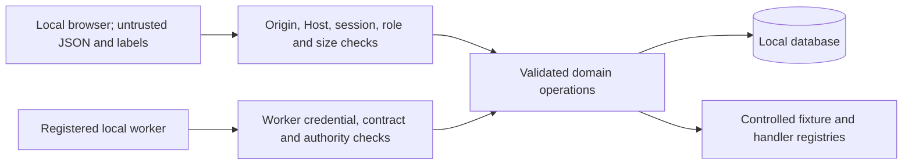

# Local access and threat model

This release uses fictional roles to demonstrate authorization. It does not provide production authentication, a sandbox for hostile code, or a public internet service.

| ID | Threat or mistake | Required control and verification |
| --- | --- | --- |
| SEC-01 | Another website sends local mutations | Bind 127.0.0.1; same origin; strict Origin/Host allowlist; reject unexpected origins and cross-site requests |
| SEC-02 | A role selector bypasses permissions | Server maps disposable demo session to role; check every action; test direct unauthorized API calls |
| SEC-03 | A worker changes an old result | Validate worker/task/attempt/fence, phase and time in each new write transaction |
| SEC-04 | Definition text executes | Allowlisted handler names/versions; no eval, SQL interpolation, dynamic import, shell or executable templates |
| SEC-05 | Inputs escape local boundaries | Resolve fixture/artifact IDs through controlled registries; reject user-supplied paths/URLs |
| SEC-06 | A label/report injects HTML | Escape text, fixed content rendering, attachment downloads and nosniff; no arbitrary HTML report rendering |
| SEC-07 | Large input blocks the machine | Enforce raw byte, graph, JSON depth, field/string, artifact, page, and execution limits |
| SEC-08 | Credentials leak | Generate disposable values, redact logs, exclude runtime state from Git, keep tokens out of URLs |
| SEC-09 | Fault controls escape tests | Disabled by default; explicit local test mode, separate harness token, no production exposure |
| SEC-10 | Data is silently destroyed | Explicit migrations/reset targets, verified snapshots, no auto-delete or startup reset |

## Role matrix

| Action | Author | Operator | Reviewer | Worker |
| --- | --- | --- | --- | --- |
| Read shared demo definitions/run history | Yes | Yes | Yes | Assigned input only |
| Draft/edit/validate/publish/delete draft | Yes | No | No | No |
| Start/pause/resume/cancel | No | Yes | No | No |
| List and decide pending approvals | No | No | Matching reviewer role | No |
| Read report artifact | Through authorized run | Through authorized run | Pinned request/report | Assigned allowed artifacts |
| Register/claim/heartbeat/complete | No | No | No | Own registered instance and current attempt |
| Metrics/diagnostics | Read | Read | Basic readiness | Own protocol readiness |

A startup-generated one-time local bootstrap value establishes a disposable browser session with HttpOnly, SameSite=Strict cookie. Choosing a fictional role through the local demo flow is explicitly labeled demonstration identity. Mutations require same-origin checks plus session-bound anti-CSRF header. Worker bearer credentials use a separate scope; browser sessions cannot invoke worker completion endpoints. Exact bootstrap implementation is a pre-release item; never reuse real account credentials.

JSON must reject duplicate keys, invalid Unicode, nonfinite numbers, excessive nesting (proposed 32 levels), and unsupported fields. Bound node IDs to the schema pattern. Unexpected server failures return a stable error and correlation ID without a stack trace. Keep runtime storage on a local supported filesystem with normal per-user access; machine administrators and hostile local processes are outside this demonstration's trust boundary.

AC-25 and AC-27 verify these controls, including direct API calls and unexpected Origin/Host values, rather than relying only on hidden browser buttons.
