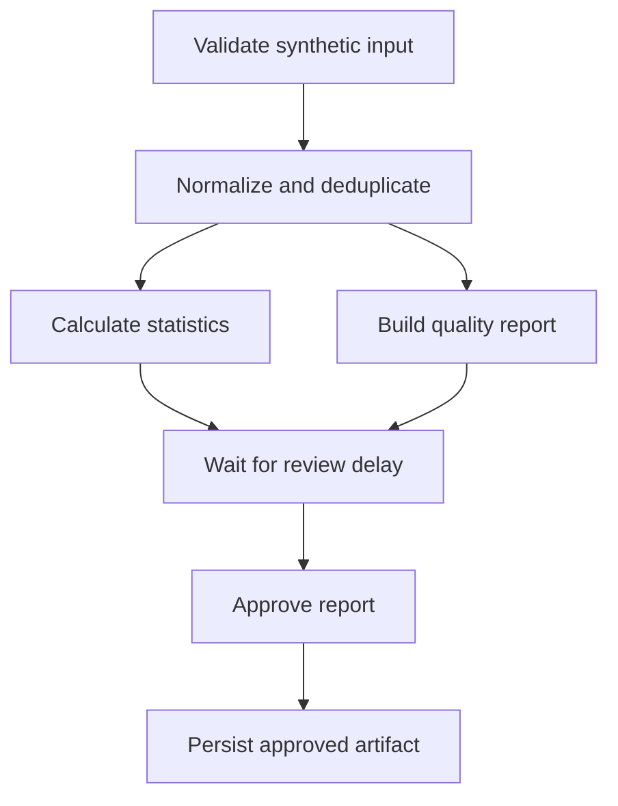
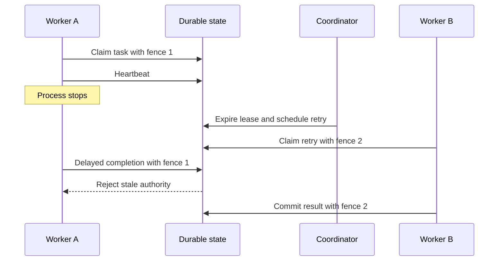
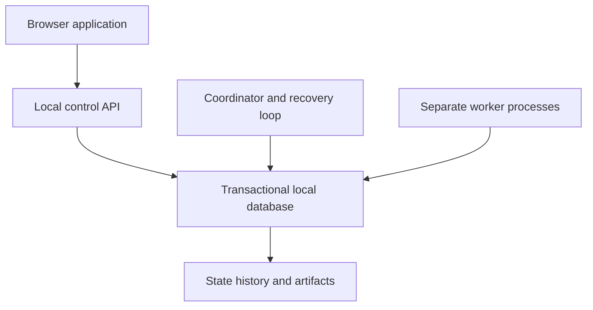

# Durable Workflow Engine Requirements

Version 0.1 | Language agnostic | Proposed engineering scope | 19 November 2026

## 1 Purpose

Build a durable workflow engine that runs dependent tasks, persists progress, retries recoverable failures, supports timers and human decisions, and recovers when a worker or coordinator process stops. A browser application lets an operator define workflows, start runs, inspect progress and investigate failures.

The first release runs entirely on one machine using separate local processes and a transactional local database. It must demonstrate correctness through controlled failures and repeatable tests. It is not a claim of production readiness or distributed consensus across machines.

This is an engineering reference for review and revision. Product choices and provisional targets below are proposals, not existing implementation results. It does not establish approval under the evaluation programme. That programme separately requires participant ownership of the project idea, permitted code, and answers written by the participant.

## 2 Problem and intended users

A simple background task runner often loses progress after a restart, repeats work after a timeout, or leaves operators unable to explain what happened. This project addresses those problems for workflows whose steps can take different amounts of time and may require independent review.

| User | Need |
| --- | --- |
| Workflow author | Define dependent steps, inputs, retry rules and deadlines without changing engine code. |
| Operator | Start and monitor runs, pause new work, cancel runs and inspect failed attempts. |
| Reviewer | Approve or reject a specific pending decision with an auditable record. |
| Developer | Add registered task handlers and verify failure and recovery behaviour. |

The local demonstration uses fictional identities and synthetic fixtures. It does not connect to real customer accounts or process confidential data.

## 3 End state and release scope

Success means an operator can publish a valid workflow, execute it with several local workers, interrupt processes, restart them, and observe correct completion or an explicit terminal failure. History must explain each attempt and decision. Completed steps must not be scheduled again during automatic recovery.

### Required in the first release

- Immutable workflow definition versions expressed as JSON.
- Directed acyclic graphs with multiple roots, parallel branches and AND joins.
- Registered worker tasks, durable timer nodes and approval nodes.
- Persistent workflow runs, task states, attempts, results and ordered history.
- Atomic task claiming, leases, heartbeats and stale-worker fencing.
- Bounded retries, execution deadlines and worker-loss recovery.
- Run pause, resume, cancellation and terminal-state enforcement.
- Idempotent start requests and deduplicated built-in task effects.
- Browser definition editor, run dashboard, run detail, approval inbox and worker view.
- Local startup scripts, migrations, fixtures and automated correctness tests.

### Deferred

- Arbitrary user code, shell commands, plugins uploaded through the browser or executable expressions in definitions.
- Cross-machine clustering, multi-region availability and consensus protocols.
- Cloud services, webhooks, email delivery, external HTTP tasks and production integrations.
- AI inference, agents, model evaluation or model training.
- Cron scheduling, child workflows, loops, conditional branches and compensation workflows.
- Live editing of running definitions, manual resurrection of failed runs and partial reruns.
- Drag-and-drop authoring, mobile applications and native desktop interfaces.
- Production identity providers, real secrets and public internet deployment.

These exclusions keep the release focused on durability and correctness. They are not substitutes for the required features.

## 4 Desktop and policy constraints

| Constraint | Requirement |
| --- | --- |
| No internet or cloud services | All runtime operations use the local machine. Serve browser assets locally; no CDN, telemetry or external authentication. |
| No Docker | Launch the database, coordinator and workers as ordinary local processes. |
| No GPU or sound | All functionality and acceptance tests use CPU, files, database records and browser interactions. |
| Browser interface | The complete operator and reviewer interface opens in the supplied browser. |
| Restricted packages | Verify dependency availability through the supplied mirror before selecting an implementation stack. |
| Single engineer workspace | Multiple browser tabs and local processes demonstrate roles and concurrency. No second machine or person is required. |
| No private data | Use generated records and fictional roles. Import no employer logs, real credentials, customer files or personal documents. |
| Approval before sessions | Submit the chosen scope for programme approval before beginning work in its evaluation workspace. |

The requirements do not mandate a language, framework, broker, ORM or database product. A transactional database with enforced constraints and a reliable concurrent claim mechanism is required. Supporting multiple database products is not a first-release requirement.

## 5 Reference demonstration

Use a synthetic data processing workflow:

1. Validate a generated dataset and record rejected rows.
2. Normalize valid records and deduplicate them.
3. Calculate summary statistics and a quality report in parallel.
4. Wait for a durable two-second review delay.
5. Request human approval of the specific report version.
6. Persist one approved report artifact.

The canonical fixture contains 10,000 rows: 9,850 distinct valid records, 100 extra copies of valid records and 50 invalid records with distinct IDs. The expected normalized output contains 9,850 records. Generation uses a recorded seed and canonical output ordering. Fixtures include machine-readable expected counts and output digests.

The demo handler for report publication writes its effect into the same database as engine state. It does not email, upload or modify an external system.



## 6 Terminology and guarantees

| Term | Meaning |
| --- | --- |
| Definition version | Immutable published workflow graph and configuration. |
| Run | One execution of exactly one published version with immutable initial input. |
| Task instance | A node within a run, distinct from the reusable handler implementation. |
| Attempt | One claim and execution opportunity for a worker task. |
| Lease | Time-bounded authority for a worker to update an attempt. |
| Fence token | Monotonically increasing generation identifying the currently authorized attempt. |
| Effect key | Stable identity for a logical effect across automatic retries. |
| History event | Durable ordered record of a state transition or accepted control action. |

The engine offers at-least-once worker execution with fenced state updates. A worker can execute and crash before its completion is recorded, so execution may repeat. The engine must not advertise universal exactly-once execution.

Built-in database effects are deduplicated using a stable effect key and atomic transactions. This proves one committed logical effect for those handlers, not for arbitrary external systems. A handler with an external side effect would need its own idempotency protocol and is outside the initial scope.

The authoritative source of truth is committed database state. Browser state, worker memory and process logs are not authoritative. History is an audit trail; reconstructing all state through event sourcing is not required.

## 7 Workflow definition contract

| ID | Requirement |
| --- | --- |
| DEF-01 | An author can create, edit, validate and delete unpublished drafts. |
| DEF-02 | Publishing creates an immutable version with an ID, version number, canonical content digest and publication timestamp. |
| DEF-03 | A run binds to a published version and digest permanently. Later versions affect only new runs. |
| DEF-04 | Validation rejects cycles, duplicate node IDs, missing dependencies, self-dependencies and unknown node types or handler versions. |
| DEF-05 | Validation rejects invalid retry policies, nonpositive timeouts, excessive sizes and references to unavailable upstream output. |
| DEF-06 | Inputs use literal JSON values and structured references. No eval, scripts, SQL or templated executable expressions are accepted. |
| DEF-07 | Every worker handler declares its input contract, output contract and supported version. |
| DEF-08 | Errors identify the node, field and reason. Invalid definitions never create executable work. |
| DEF-09 | A definition has 1 to 100 nodes, at most 500 edges, and a maximum encoded size of 256 KiB. These are configurable limits. |

Illustrative contract, subject to the final schema:

```json
{
  "schemaVersion": 1,
  "name": "synthetic-report-review",
  "nodes": [
    {
      "id": "build",
      "kind": "worker",
      "handler": "build-report",
      "handlerVersion": 1,
      "dependsOn": [],
      "input": {"fixtureId": {"runInput": "/fixtureId"}},
      "timeoutSeconds": 30,
      "retry": {
        "maxAttempts": 3,
        "initialDelaySeconds": 1,
        "multiplier": 2,
        "maxDelaySeconds": 10
      }
    },
    {
      "id": "review-delay",
      "kind": "timer",
      "dependsOn": ["build"],
      "durationSeconds": 2
    },
    {
      "id": "review",
      "kind": "approval",
      "dependsOn": ["review-delay"],
      "reviewerRole": "reviewer",
      "decisionTimeoutSeconds": 3600,
      "input": {"report": {"nodeOutput": "build", "pointer": "/report"}}
    },
    {
      "id": "publish",
      "kind": "worker",
      "handler": "persist-approved-report",
      "handlerVersion": 1,
      "dependsOn": ["review"],
      "input": {"report": {"nodeOutput": "build", "pointer": "/report"}},
      "timeoutSeconds": 30,
      "retry": {"maxAttempts": 3, "initialDelaySeconds": 1, "multiplier": 2, "maxDelaySeconds": 10}
    }
  ]
}
```

Output references may target transitive ancestors, never unrelated parallel nodes or descendants. A missing required value fails the consuming node with a nonretryable input-resolution error. Definition validation checks structural references; runtime validation checks actual values.

## 8 Run lifecycle and scheduling

| ID | Requirement |
| --- | --- |
| RUN-01 | Starting a run atomically creates its record, node instances, initial readiness and first history event. |
| RUN-02 | Start requires a caller-supplied idempotency key. Repeating the same key and canonical request returns the same run; a different request with that key returns a conflict. |
| RUN-03 | A node becomes executable only after all dependencies succeed. Roots have no dependency barrier. |
| RUN-04 | Independent eligible nodes may execute concurrently, within global, per-run and per-handler limits. |
| RUN-05 | Dispatch selects eligible work by ready timestamp and stable task ID, subject to capacity and lock availability. Strict global FIFO is not promised. |
| RUN-06 | Only registered compatible workers may claim a handler version. Missing worker capability is visible rather than silently skipped. |
| RUN-07 | A node exhausted by failure initiates fail-fast settlement: stop new claims and cancel or skip remaining work as specified below. |
| RUN-08 | All node and run transitions use transactions, transition preconditions and durable events. |
| RUN-09 | A run has a finite configurable deadline, default 24 hours. Expiry initiates failure settlement with a deadline reason. |

Run lifecycle values are QUEUED, ACTIVE, FAILING, CANCELLING, SUCCEEDED, FAILED and CANCELLED. SUCCEEDED, FAILED and CANCELLED are terminal. A separate pause flag controls dispatch while QUEUED or ACTIVE. WAITING, RUNNING and PAUSED are presentation labels derived from durable state; they are not competing lifecycle records.

A run succeeds only when every node succeeds. A failed run becomes terminal only after no authorized execution remains. A cancelled run becomes terminal only after all remaining nodes have settled or been fenced. Terminal runs reject further execution or control mutations, apart from idempotent repeats of already accepted requests.

## 9 Task and attempt state contracts

Task states: BLOCKED, READY, RUNNING, RETRY_WAIT, WAITING_TIMER, WAITING_APPROVAL, SUCCEEDED, FAILED, SKIPPED and CANCELLED.

| From | To | Condition |
| --- | --- | --- |
| BLOCKED | READY | Worker node dependencies succeed and run allows activation. |
| BLOCKED | WAITING_TIMER | Timer dependencies succeed; persist due timestamp. |
| BLOCKED | WAITING_APPROVAL | Approval dependencies succeed; persist request and input digest. |
| READY | RUNNING | Atomic claim creates an attempt and fence token. |
| RUNNING | SUCCEEDED | Current unexpired attempt commits valid output. |
| RUNNING | RETRY_WAIT | Retryable error, lease loss or timeout with budget remaining. |
| RUNNING | FAILED | Nonretryable error or exhausted attempt budget. |
| RETRY_WAIT | READY | Persisted retry timestamp is due and run permits dispatch. |
| WAITING_TIMER | SUCCEEDED | Due timestamp reached and run remains active or paused. |
| WAITING_APPROVAL | SUCCEEDED | Authorized reviewer approves the current request. |
| WAITING_APPROVAL | FAILED | Rejection or decision deadline expiry. |
| Any unfinished state | CANCELLED or SKIPPED | Cancellation or failure settlement rules apply. |

Each attempt is RUNNING, SUCCEEDED, FAILED, TIMED_OUT, LOST or CANCELLED. Task and attempt terminal outcomes must agree where applicable. A task cannot have two authorized RUNNING attempts. Succeeded outputs are immutable.

Settling failure marks never-started work SKIPPED with a reason and requests cancellation of active work. Active attempts cannot later make the run succeed. Approval and timer nodes consume no worker attempt slots.

## 10 Claims leases and recovery

| ID | Requirement |
| --- | --- |
| DUR-01 | Claiming a task atomically checks run eligibility and capacity, records the worker, increments the fence token, creates the attempt and stores lease expiry. |
| DUR-02 | Every heartbeat, result and effect commit identifies the task, attempt and fence token. Stale, expired or cancelled authority is rejected. |
| DUR-03 | Default lease duration is 15 seconds; heartbeat interval is 5 seconds; expiry scan interval is at most 1 second. |
| DUR-04 | A heartbeat extends a valid lease but never extends the fixed attempt execution deadline. An expired lease cannot be revived. |
| DUR-05 | Worker loss closes the attempt as LOST and follows retry policy. Each claim consumes an attempt, including claims lost before useful work. |
| DUR-06 | Starting or restarting a coordinator reconciles overdue retries, timers, approvals and expired leases without resetting their timestamps. |
| DUR-07 | Database time is authoritative for durable deadlines. Process-local monotonic clocks may measure durations but do not replace persisted due times. |
| DUR-08 | If the database becomes unavailable, workers stop accepting work and cannot commit effects. Resume only after authority is revalidated. |
| DUR-09 | Multiple coordinator processes may coexist locally without double activation or double settlement; no process-local lock is the sole correctness mechanism. |
| DUR-10 | A database restart retains committed state. An unacknowledged request may have committed, so clients retry using the same idempotency key. |

The implementation must document its transaction isolation, lock order, claim strategy and retry treatment for deadlocks or transaction conflicts. Candidate-row locking alone is insufficient for shared concurrency limits: capacity accounting and run-control preconditions must be enforced atomically too.



## 11 Retry and timeout semantics

- maxAttempts includes the initial attempt. The default is 3; permitted range is 1 to 10.
- Delay after failed attempt n is min(maxDelay, initialDelay × multiplier^(n−1)). Persist the selected next-eligible timestamp once.
- Optional jitter is configurable and disabled in deterministic tests. Restart never recalculates a persisted delay.
- Explicit transient task errors, worker loss and execution timeout are retryable. Input errors, unknown handler versions and approval rejection are nonretryable.
- Task output must satisfy its handler output contract before success is committed.
- Task execution timeout begins at claim and does not include prior queue time. Run deadline includes queueing, retries, timers and approvals.
- When a timeout wins the transaction race, later success is rejected. When a valid success commits first, the timeout action has no effect.
- A process that cannot be stopped immediately loses authority at timeout. Built-in effects remain fenced even if its computation continues.
- Exhaustion is visible with final error code, attempts, timestamps and remediation guidance. A fresh run uses a new run ID and effect namespace; partial manual retry is deferred.

## 12 Effects and idempotency

| ID | Requirement |
| --- | --- |
| EFF-01 | Built-in effect keys combine run ID, node ID and operation name. They do not contain attempt number. |
| EFF-02 | Before committing an effect, verify current lease, fence token, run phase and attempt deadline in the transaction. |
| EFF-03 | A unique constraint prevents two committed effects with the same key. Existing effect content must match the expected digest; mismatches fail explicitly. |
| EFF-04 | Built-in effect record, task output, attempt success, task success and completion history commit in one database transaction. |
| EFF-05 | If a completion response is lost after commit, an identical completion retry returns the original receipt. Changed content or a superseded unfinished attempt is rejected. |
| EFF-06 | Successful task results and effects are never overwritten by restart, retry or a delayed worker. |

Do not wrap a nontransactional external action between two database writes and call that exactly-once delivery. First-release demonstrations use database-contained effects. Optional downloaded files are derived exports of committed artifacts, not authoritative workflow effects.

## 13 Timers approvals and controls

### Timers

Persist dueAt when a timer activates. Waiting does not occupy a worker. Restart does not restart the duration. An overdue timer settles on reconciliation. Timers already activated may settle while paused, but new dependent work cannot start until resume.

### Approvals

- Request identity includes run ID, node ID, definition version, resolved input digest and decision deadline.
- Reviewers see the exact data being approved. They cannot edit it through the decision form.
- Approve and reject requests carry an idempotency key and expected request version.
- An accepted decision and its task transition commit together with actor and timestamp.
- Identical duplicate decisions return the same receipt. Conflicting, stale, expired, unauthorized or cancelled decisions are rejected.
- Default decision deadline is one hour; a workflow can configure another finite duration within the run deadline.
- Review while paused is allowed. Approval may settle the node; downstream dispatch remains paused.
- Rejecting a request or reaching its deadline initiates failure settlement. Late approval cannot reopen it.

### Pause and resume

Pause prevents claims and activation of new nodes after its transaction commits. Already authorized attempts may complete and persist results; pause is not suspension of running code. Pending approvals and active timer deadlines continue to advance. Resume restores eligibility without resetting attempts or deadlines. Repeated pause or resume is idempotent.

### Cancellation

Cancellation atomically moves a nonterminal run to CANCELLING and prevents new work. Invalidate active attempt authority, mark pending approvals and timers cancelled, and preserve all previously committed effects. Cancellation does not roll back completed work. If success and cancellation race, the first valid committed transition determines the outcome. The UI displays the accepted outcome.

## 14 Architecture requirements



Workers may use a local worker API instead of connecting directly to the database. Either implementation must preserve the same transaction, lease and fencing contracts. The architecture diagram shows logical responsibilities, not a mandatory deployment topology.

| Component | Responsibility |
| --- | --- |
| Control API | Definition management, idempotent starts, run controls, decisions and read APIs. |
| Coordinator | Dependency activation, timer/retry expiry, lost-attempt reconciliation and run settlement. |
| Worker | Claim compatible work, heartbeat, execute allowlisted handlers and submit fenced completion. |
| Database | Authoritative records, uniqueness, conditional updates, ordering and atomic commits. |
| Browser | Authoring, operator actions, review, progress and investigation. |
| Test harness | Generate fixtures, control processes, inject failures and verify invariants. |

No message broker is required. Durable queue state may reside in the database. Restart and recovery must not depend on an in-memory queue surviving.

## 15 Logical data model

| Entity | Required information |
| --- | --- |
| DefinitionDraft | ID, name, mutable document, revision and timestamps. |
| DefinitionVersion | ID, workflow ID, version, immutable canonical JSON, digest and publication time. |
| Run | ID, definition reference, input and digest, start key, lifecycle, pause flag, deadline, revision and timestamps. |
| TaskInstance | Run/node identity, state, resolved input digest, output reference, eligible time, fence counter and revision. |
| Attempt | Task ID, attempt number, worker ID, fence, lease expiry, execution deadline, outcome and error summary. |
| ApprovalRequest | Task ID, input digest, request revision, reviewer role, deadline and decision state. |
| ApprovalDecision | Request ID, decision, fictional actor, reason, key and timestamp. |
| Effect | Stable key, canonical payload digest, payload or artifact reference and originating task. |
| Artifact | ID, content type, bounded bytes, digest and creation timestamp. |
| HistoryEvent | Run ID, monotonically increasing per-run sequence, event type, actor, entity ID and bounded payload. |
| Worker | Process instance ID, supported handlers, last seen time and capacity. |
| IdempotencyReceipt | Operation scope, key, canonical request digest and durable response reference. |

Required constraints include unique definition versions, one task per run/node, unique task/attempt numbers, unique effect keys, unique operation-scoped idempotency keys and unique run/history sequences. References must prevent orphan records. Terminal tasks retain their attempt and result history.

Indexes must support ready task lookup, expired lease lookup, due timer/retry lookup, filtered run lists, pending approvals and ordered run history. Payload limits and pagination apply before returning data.

State transitions and corresponding history events commit atomically. Per-run event sequence allocation must serialize correctly; wall-clock timestamps are not event ordering keys. Failed transactions consume no visible state change or audit event.

## 16 API contract

The path names are proposed. Equivalent interfaces are acceptable if they preserve behaviour and are documented.

| Method and path | Behaviour |
| --- | --- |
| GET /api/health | Process liveness without reporting database readiness as healthy. |
| GET /api/ready | Database connectivity and schema compatibility. |
| GET /api/handlers | Registered types, versions and input/output contracts. |
| POST /api/definitions/drafts | Create draft. |
| PUT /api/definitions/drafts/{id} | Update using expected revision. |
| POST /api/definitions/drafts/{id}/validate | Return structured errors or normalized valid form. |
| POST /api/definitions/drafts/{id}/publish | Publish immutable version idempotently. |
| GET /api/definitions/{id}/versions | List versions and digests. |
| POST /api/runs | Start run with definition version, input and idempotency key. |
| GET /api/runs | Filter and paginate runs. |
| GET /api/runs/{id} | Return durable run snapshot, revision and task summaries. |
| POST /api/runs/{id}/pause | Pause dispatch. |
| POST /api/runs/{id}/resume | Resume dispatch. |
| POST /api/runs/{id}/cancel | Request cancellation. |
| GET /api/runs/{id}/tasks/{nodeId} | Inputs, result, attempts, lease and error details. |
| GET /api/runs/{id}/history | Cursor pagination by event sequence. |
| GET /api/approvals | List pending decisions permitted for the fictional role. |
| POST /api/approvals/{id}/decision | Approve or reject using expected revision and key. |
| GET /api/workers | Worker capabilities, heartbeat age and active attempts. |
| GET /api/artifacts/{id} | Download authorized bounded artifact. |
| GET /api/metrics | Local operational counters and timings in a documented format. |

All mutation APIs define operation-scoped idempotency behaviour. Optimistic edits and decisions use expected revisions. Invalid input returns 400 or 422 consistently; missing resources 404; insufficient permissions 403; stale revisions or conflicting keys 409; temporary database unavailability 503. Error responses include a stable code, message, field details where applicable, and correlation ID without stack traces or credentials.

Lists default to 50 items and allow at most 200. JSON requests and responses are bounded. Run snapshots expose a history high-water mark so the browser can load subsequent events without gaps. Browser polling is sufficient; WebSockets and server-sent events are optional.

## 17 Browser experience

| Screen | Required functions |
| --- | --- |
| Definitions | List drafts/versions, edit JSON, validate, show errors and publish. |
| Start run | Select an immutable version and synthetic fixture; show validation before submission. |
| Run dashboard | Filter by lifecycle, workflow and time; identify paused, failed and overdue runs. |
| Run detail | Dependency graph or accessible structured equivalent, node states, progress, controls and event timeline. |
| Task detail | Attempt history, input/output, failure reason, next retry time and lease information. |
| Approval inbox | Inspect exact report/version, approve or reject, show conflicts without silently retrying a changed decision. |
| Workers | Capability, active attempts, capacity, heartbeat age and lost-worker status. |
| Diagnostics | Readiness, schema version, settings, counters and explicit dependency errors. |

Use visible status text as well as colour. All controls must support keyboard operation. Confirm cancellation with a clear explanation that completed effects remain. Disable unsupported actions and explain why. Distinguish accepted, pending, completed and failed actions.

Refresh or browser closure must not affect execution. Two tabs must converge to authoritative state. The UI handles loading, empty, stale, disconnected, permission-denied and backend-error states. It must not report success before the server confirms durable acceptance.

## 18 Local access and data boundaries

Bind services to loopback by default. Use same-origin browser access and reject unexpected origins for mutations. Do not accept arbitrary filesystem paths or URLs in task inputs. Fixture IDs and artifact IDs resolve through controlled registries.

Provide fictional operator, author and reviewer identities for demonstration. Server-side role checks must be exercised by tests; selecting a role in a browser is demonstration identity, not production authentication. If local session tokens are needed, generate disposable values at startup, keep them out of URLs and source control, and never reuse real account credentials.

Apply request-size limits, JSON validation, HTML escaping and bounded error details. Logs must not contain authentication values. General-purpose sandboxing and production identity management are outside scope. Fault-injection controls are disabled in normal mode and available only to the test harness or explicitly enabled local demonstration mode.

## 19 Observability and operational behaviour

History must include definition publication, run creation, pause/resume/cancel, dependency readiness, claim, retry scheduling, lease loss, task outcome, timer settlement, approval outcome and terminal run settlement. Heartbeats need not create individual history events.

Every diagnostic record includes applicable run, node, attempt, worker and correlation IDs. Store bounded structured error codes and messages. Paginate history rather than loading it all at once.

Metrics include ready/running tasks, retry counts, expired leases, fenced updates rejected, workflow outcomes, oldest ready-task age, active workers, approval age and task/run duration distributions. Metrics aid diagnosis and do not replace durable history.

Startup checks schema compatibility and required dependencies before accepting work. Graceful worker shutdown stops new claims and attempts bounded completion; hard shutdown relies on lease expiry. Graceful coordinator shutdown preserves all due timestamps and durable records. Automatic database reconnect uses bounded backoff without inventing successful commits.

Provide versioned schema migrations. Refuse an unknown newer schema. Never silently delete or reset the database. Backup/restore instructions must preserve definitions, runs, history, effects and idempotency receipts together using the selected database's consistent snapshot mechanism.

## 20 Provisional performance and resource targets

These are targets to confirm against the supplied desktop, not measured promises. Record CPU, RAM, database version, worker count, fixture sizes and measurement method with every result.

| Measure | Initial target and conditions |
| --- | --- |
| Graph size | 100 nodes and 500 edges validated within 1 second at p95 over 100 representative definitions. |
| Local concurrency | 4 worker processes and 100 simultaneous active runs without invariant violations. |
| Scheduler responsiveness | p95 eligibility-to-claim within 2 seconds when matching capacity is free and the database is healthy. |
| Recovery | Expired work reconsidered within 5 seconds after lease expiry when coordinator and database are available. |
| Read APIs | p95 within 500 ms for paginated lists with 10,000 retained runs and 100,000 events. |
| UI updates | Accepted server state visible within 3 seconds under healthy local polling. |
| Local throughput | At least 10 completed trivial worker tasks per second over 60 seconds with 4 workers; approvals and task business computation excluded. |
| Resource budget | Target under 2 GiB total steady-state RAM for services and database, excluding browser and build tools. |
| Soak | 30 minutes with bounded fixture generation, no stuck eligible tasks and no steadily growing process-memory trend after warm-up. |

Correctness takes priority over throughput. Change targets only with recorded measurements and an explained scope decision. Artificially sleeping handlers are excluded from scheduler throughput results.

## 21 Acceptance suite

All scenarios use synthetic fixtures, local processes and an isolated test database. Durable assertions query committed records, not only UI messages.

| ID | Scenario | Required evidence |
| --- | --- | --- |
| AC-01 | Publish valid definition | Immutable version/digest exists and can start a run. |
| AC-02 | Reject invalid graphs | Cycles, duplicates, missing handlers and invalid references produce precise errors and no work. |
| AC-03 | Pin version | Publishing version 2 does not change a run started on version 1. |
| AC-04 | Parallel branches and join | Independent branches overlap; join starts only after both succeed. |
| AC-05 | Transient failures | A handler failing its first two attempts succeeds on attempt 3 with persisted delays. |
| AC-06 | Retry exhaustion | Final failure stops dispatch and settles remaining nodes with explicit reasons. |
| AC-07 | Hard worker kill | Kill after claim; expiry records LOST and another worker recovers within the configured bound. |
| AC-08 | Coordinator restart | Existing runs, retry timestamps and timer due times survive; no successful node reruns. |
| AC-09 | Stale completion | Old worker result and heartbeat after replacement are rejected; accepted result remains unchanged. |
| AC-10 | Effect crash before commit | Termination before the atomic commit leaves no effect or success; retry produces one effect. |
| AC-11 | Lost response after commit | Retry same completion and start requests; return original receipts with one effect and one run. |
| AC-12 | Competing claims | Four workers repeatedly contend for ready work; no task has two authorized attempts. |
| AC-13 | Multiple coordinators | Two coordinators reconcile concurrently without duplicate activation, decision or terminal events. |
| AC-14 | Capacity limits | Global, run and handler active counts never exceed their configured limits under contention. |
| AC-15 | Pause during execution | Existing attempts can finish; no new claim or node activation commits after pause until resume. |
| AC-16 | Cancel races | Pending work stops; stale completions fail; previously committed effects remain visible. |
| AC-17 | Approval after restart | Same request/input digest remains pending and can receive one valid decision. |
| AC-18 | Conflicting decisions | Two tabs approve/reject concurrently; one valid decision commits and the other receives conflict. |
| AC-19 | Approval expiry | Timeout fails the node; late approval cannot reopen it. |
| AC-20 | Durable timer | Restart halfway through wait; original due time is retained and successor executes once eligible. |
| AC-21 | Attempt timeout | Heartbeats do not extend execution deadline; late result cannot commit. |
| AC-22 | Database outage/restart | No fake success while unavailable; committed history returns and pending work recovers afterward. |
| AC-23 | Full demo | Canonical input yields 9,850 normalized records, expected counts/digest, approval and one published artifact. |
| AC-24 | Browser reload and two tabs | UI recovers accurate snapshots and accepted controls; execution continues without an open browser. |
| AC-25 | Input boundaries | Oversized input, executable expressions, path escape, unknown fixture and unauthorized actions are rejected. |
| AC-26 | Deadline and failure races | Run deadline and task success settle according to transactional order with no terminal-state reopening. |
| AC-27 | Offline operation | Start, execute, approve, recover and inspect runs with external network unavailable. |
| AC-28 | Backup restoration | Consistent snapshot restores run, effects and receipts; recovery creates no duplicate logical effects. |

Crash testing must include deterministic barriers at: after claim; after effect preparation but before transaction commit; after commit but before response; and after timeout or cancellation before delayed completion. Timing-dependent random sleeps alone are insufficient evidence.

Run claim, capacity and stale-update tests for at least 100 repeated contention rounds. Repeat each crash-window scenario at least 20 times. Report failures rather than removing unstable cases.

Useful invariants for automated checking: terminal states never reopen; every accepted transition has one durable event; event sequences are unique and increasing; effect keys are unique; successful nodes have valid outputs; dependency barriers hold; no cancelled or stale attempt commits; and no active-capacity counter becomes negative or exceeds its limit.

## 22 Session plan and milestone exits

The sessions are proposed work units, not fixed time estimates. Difficult milestones may span several sessions and many turns. Each ends with runnable behaviour, relevant tests, a commit or checkpoint and a short continuation note.

| Session | Work | Exit condition |
| --- | --- | --- |
| 1 | Choose stack after dependency check; define invariants, state machines and local layout. | Browser opens locally, database connects, readiness fails correctly when unavailable, architecture decisions recorded. |
| 2 | Draft schema, validation, version publication and database migrations. | Valid DAG publishes; invalid graph suite passes; versions remain immutable. |
| 3 | Run creation, root readiness and one simple worker. | A short sequential workflow completes with persistent task and attempt records. |
| 4 | Parallel branches, joins and bounded claiming. | Dependency and contention tests pass with multiple workers. |
| 5 | Leases, heartbeat, fencing and coordinator reconciliation. | Hard-kill and delayed-completion scenarios pass. |
| 6 | Retry classification, backoff and attempt/run deadlines. | Restart preserves retries and deadlines; exhaustion settles correctly. |
| 7 | Transactional built-in effects and durable idempotency receipts. | Before/after-commit crash windows produce one logical effect. |
| 8 | Timers, approvals and conflicting decisions. | Waits survive restart; concurrent decisions resolve consistently. |
| 9 | Pause, resume, cancellation and failure settlement races. | No post-control unauthorized claims or effects; terminal states remain final. |
| 10 | Complete browser authoring, run inspection and approval experience. | Browser journey and two-tab tests pass with error and stale-state handling. |
| 11 | Full synthetic report demo, metrics, limits and load measurements. | Counts/digests match; provisional performance results and resource use recorded. |
| 12 | Full failure matrix, backup/restore, offline startup and handover. | Acceptance report, repeatable startup instructions and known limitations complete. |

History and basic diagnostics begin with the first run implementation; the browser grows throughout these sessions. The final UI session consolidates the experience rather than postponing all visibility until late development.

## 23 Deliverables and definition of done

Required deliverables:

1. Source code and permitted third-party licence notices.
2. Definition schema, example workflows and handler contracts.
3. Versioned database migrations and entity/constraint documentation.
4. Local launch, shutdown, reset-test-data and dependency-check instructions.
5. Browser application with all required operator and review flows.
6. Synthetic fixture generator and canonical expected outputs.
7. Unit, integration, concurrent-process and browser test suites.
8. Fault-injection harness with disabled-by-default controls.
9. Acceptance report listing each AC identifier, observed outcome and evidence location.
10. Architecture decisions, measured performance report, backup/restore guide and known limitations.
11. Per-session continuation record identifying completed work, current failures and the next milestone.

Release is done when required acceptance scenarios pass from documented local setup, failure tests satisfy repeat counts, the full demonstration can be repeated offline, and no unresolved correctness defect compromises stated guarantees. A polished dashboard alone is insufficient; a backend with no complete browser journey is also incomplete.

## 24 Decisions to make before implementation

| Decision | Constraint |
| --- | --- |
| Language and framework | Select from desktop-supported tools; verify dependencies before committing. |
| Transactional database | Choose one supplied local database and prove atomic claiming, uniqueness and capacity accounting. |
| Worker transport | Direct local database or local API; both must enforce leases and fencing. |
| Payload contracts | Choose a bounded validation format and canonical serialization for digests. |
| Process packaging | Define ordinary local commands/scripts; no containers required. |
| Browser graph rendering | Simple locally bundled rendering or an accessible structured alternative; no CDN dependency. |
| Resource targets | Measure desktop baseline and confirm or revise provisional limits explicitly. |
| Project eligibility | Participant and programme reviewer must resolve idea ownership and approve submitted scope independently of this document. |

## 25 Technical references

These references explain relevant primitives. They do not require adopting those products or copying their implementation.

- Temporal workflow concepts: https://docs.temporal.io/workflows
- PostgreSQL SELECT and row-locking options: https://www.postgresql.org/docs/current/sql-select.html
- PostgreSQL transaction isolation: https://www.postgresql.org/docs/current/transaction-iso.html
- SQLite atomic commit concepts: https://www.sqlite.org/atomiccommit.html

PostgreSQL documents SKIP LOCKED as a useful option for queue consumers, with limitations for general reads. A chosen database needs an equivalent tested claim protocol; the SQL clause itself is not a complete durability design. Transaction isolation must be combined with explicit constraints and conditional transitions.
