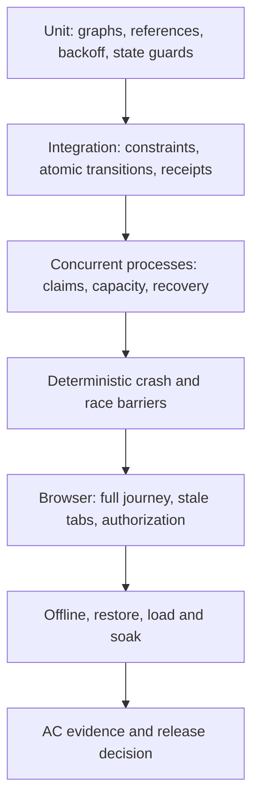

# Verification strategy

The engine earns its guarantees through committed-state assertions and controlled failures. Application tests are planned, not run, because this repository currently contains design documents and contracts.

Unit tests cover graph validation/ancestor sets, binding resolution, contract validation, JCS vectors, retry arithmetic, and legal state transitions. Integration tests use a real isolated SQLite database to prove foreign keys, unique effects, immutable records, transaction rollback, event sequences, and receipt replay. Concurrent-process tests exercise the actual API/coordinator/worker architecture rather than a process-local mutex substitute.

Required invariants: no terminal reopen; one authorized RUNNING attempt per task; successful output immutable and valid; dependencies all succeeded at activation; unique effect keys and matching digests; every accepted transition has its event; unique increasing event sequence; no stale/cancelled effect commit; occupancy never exceeds configured limits. Assert during contention transactions as well as afterward so brief limit violations cannot be missed.

Test exact deadline boundaries with database time and controlled test-clock adapters where needed, then confirm real database-clock integration. Equal-to-deadline is expired. Test completion/control/expiry in both serialization orders. Distinguish valid completion receipt replay from a new unauthorized completion.

Mandatory repetition: claim, capacity, and stale-write contention ≥100 rounds; every required crash window ≥20 rounds; soak 30 minutes. Preserve failing seeds/rounds. Browser checks include keyboard operation, graph table equivalence, reload, two tabs, exact approved report, stale revision conflict, unexpected origins, and disconnected/pending action states.

Release gates: all AC-01–28 pass on documented offline setup; repetition counts met; fixture counts and actual digests verified; performance measured with environment manifest; restore passes; no unresolved correctness defect. A deferred or NOT RUN item cannot be reported as passed. [Acceptance report](acceptance-report.md) is intentionally unfilled until there is implementation evidence.
